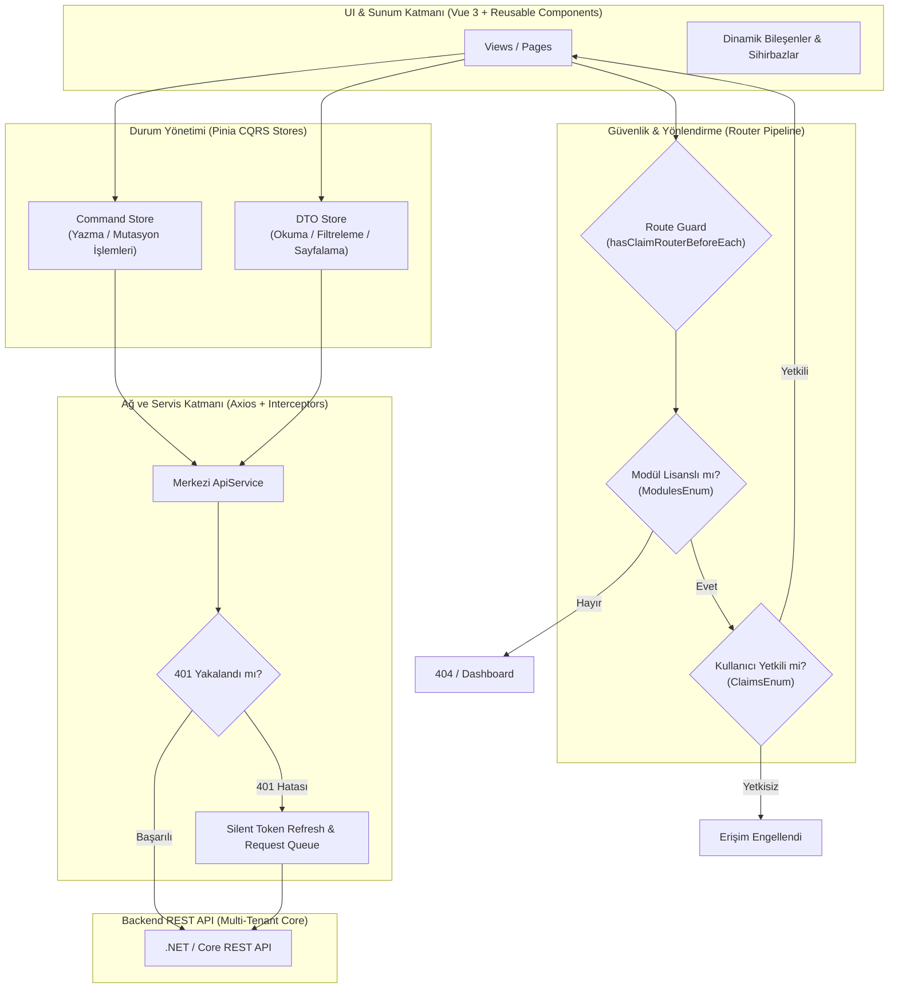

# 📊 AuditPro ERP — Denetim ve Danışmanlık Şirketleri İçin Yeni Nesil ERP Sistemi

[](https://vuejs.org/)
[](https://www.typescriptlang.org/)
[](https://vitejs.dev/)
[](https://pinia.vuejs.org/)
[](https://vuetifyjs.com/)
[](https://getbootstrap.com/)
[](#-mimari-ve-tasarım-prensipleri)
[](#-yeniden-kullanılabilir-bileşen-mimarisi-reusable-components)
[](#-multi-tenant--rbac-yetkilendirme-mimarisi)

> **Bağımsız Denetim (Audit), YMM, SMMM ve Kurumsal Finansal Danışmanlık** şirketlerinin tüm iş süreçlerini regülasyonlara (KGK, BDS / ISA, Bağımsızlık Standartları) tam uyumlu şekilde dijitalleştiren, **Multi-Tenant SaaS** mimarisine sahip, kurumsal ölçekli bir **ERP (Enterprise Resource Planning)** platformudur.

---

## 📌 İçindekiler
- [Proje Vizyonu ve Sektörel Çözüm](#-proje-vizyonu-ve-sektörel-çözüm)
- [Öne Çıkan Temel Modüller](#-öne-çıkan-temel-modüller)
- [Mimari ve Tasarım Prensipleri](#-mimari-ve-tasarım-prensipleri)
  - [1. Frontend CQRS Uyarlaması (Commands & DTOs)](#1-frontend-cqrs-uyarlaması-commands--dtos)
  - [2. Multi-Tenant ve Organizasyon Yönetimi](#2-multi-tenant-ve-organizasyon-yönetimi)
  - [3. Claims-Based RBAC ve Dinamik Rota Güvenliği](#3-claims-based-rbac-ve-dinamik-rota-güvenliği)
  - [4. Resilient Network & Silent Token Refresh Hattı](#4-resilient-network--silent-token-refresh-hattı)
- [Mimari Veri Akış Şeması](#-mimari-veri-akış-şeması)
- [🧩 Yeniden Kullanılabilir Bileşen (Reusable Component) Mimarisi](#-yeniden-kullanılabilir-bileşen-reusable-component-mimarisi)
- [Klasör ve Dosya Yapısı](#-klasör-ve-dosya-yapısı)
- [Denetim Sektörüne Özel Domain Yetenekleri](#-denetim-sektörüne-özel-domain-yetenekleri)
- [Teknoloji Yığını](#-teknoloji-yığını)
- [Kurulum ve Yerel Çalıştırma](#-kurulum-ve-yerel-çalıştırma)
- [Mühendislik Yaklaşımı ve Best Practices](#-mühendislik-yaklaşımı-ve-best-practices)

---

## 🎯 Proje Vizyonu ve Sektörel Çözüm

Denetim şirketleri, klasik hizmet şirketlerinden farklı olarak **katı yasal regülasyonlar**, **bağımsızlık kuralları**, **çıkar çatışması kısıtları** ve **zaman bazlı maliyet muhasebesi (Timesheet)** yönetimiyle çalışmak zorundadır.

Bu proje; denetim kuruluşlarının müşteri kabulünden teklif hazırlamaya, bağımsızlık kontrollerinden sözleşmeye, denetim projesi atamasından çalışanların haftalık zaman çizelgelerine ve kârlılık analizlerine kadar olan **tüm denetim yaşam döngüsünü (Audit Engagement Lifecycle)** tek bir kurumsal çatıda toplamaktadır.

```
Müşteri / Lead ──► Risk Değerlendirme & Bağımsızlık Kontrolü ──► Teklif Sihirbazı ──► Çoklu Onay Akışı
                                                                                              │
Proje Kârlılık Analizi ◄── Timesheet & Harcanan Efor ◄── Denetim Projesi & Ekip ◄── Sözleşme (Engagement Letter)
```

---

## 💼 Öne Çıkan Temel Modüller

| Modül | Tanım ve Denetim Odaklı İşlevler |
|---|---|
| **Audit CRM & Teklif Yönetimi** | Müşteri kabulü, çok adımlı teklif sihirbazı, unvan bazlı saatlik ücret tarifeleri (Billing Rates), iskonto ve marj hesaplamaları. |
| **Bağımsızlık & Çatışma Denetimi (Conflict Check)** | Denetim standartları (ISA/BDS) gereği aynı müşteriye verilemeyecek çelişkili hizmetlerin (örn: Değerleme/Muhasebe vs. Bağımsız Denetim) sistem tarafından otomatik engellenmesi. |
| **Müşteri Kabul & Risk Değerlendirmesi** | Teklif öncesi müşteri risk analizi (AML, finansal risk ve itibar skoru) şablonları ve skorlama mekanizması. |
| **Sözleşme (Engagement) Yönetimi** | Kabul edilen tekliflerin denetim sözleşmesine dönüştürülmesi, belge arşivleme ve yürürlük takibi. |
| **Denetim Projeleri (Engagements)** | Denetim ekiplerinin oluşturulması (Sorumlu Ortak Başdenetçi, Kıdemli Denetçi, Asistan vb.), bütçelenen saat ve efor hedefleri. |
| **Timesheet & Proje Maliyet Analizi** | FullCalendar destekli saatlik zaman kaydı, çakışma önleyici akıllı zaman girişi, bütçelenen vs. gerçekleşen saat ve kârlılık grafikleri. |
| **İnsan Kaynakları & Hakediş Kuralları** | Kıdem bazlı izin politikaları, hakediş sıklığı, devir kuralları, masraf/avans talepleri, eğitim ve yetkinlik şablonları. |
| **Çok Aşamalı Onay Mekanizması** | Teklifler, harcamalar, avanslar ve izinler için hiyerarşik onay süreçleri (Partner / Yönetici onay matrisleri). |
| **Varlık & Zimmet Yönetimi** | Denetçilere tahsis edilen donanım (laptop, e-imza token, test cihazları) yaşam döngüsü. |
| **Multi-Tenant Yönetim Konsolu** | Çoklu kiracı (Tenant) yapısı, paket ve modül bazlı dinamik lisanslama, kullanıcı yetki (Claim) matrisi. |

---

## 🏛️ Mimari ve Tasarım Prensipleri

Proje, kurumsal ölçekte bakım kolaylığı, yüksek ölçeklenebilirlik ve gevşek bağlılık (loose coupling) sağlamak amacıyla **Domain-Driven Design (DDD)** ve **CQRS** prensiplerinden esinlenerek tasarlanmıştır.

### 1. Frontend CQRS Uyarlaması (Commands & DTOs)
Kurumsal mimarilerde okuma (Query) ve yazma/güncelleme (Command) operasyonlarının veri yapıları birbirinden farklı gereksinimlere sahiptir. Proje genelinde bu prensip frontend seviyesinde sıkı bir şekilde uygulanmıştır:

- **Modeller Katmanında:**
  - `*Commands.ts`: Sunucu tarafında durum değişikliği oluşturan Create/Update/Delete isteklerinin payload tipleri (Örn: `CreateOfferCommand`, `CheckConflictCommand`, `ApproveOfferCommand`).
  - `*Dtos.ts`: Yalnızca veri listeleme ve görüntüleme amacıyla optimize edilmiş modeller (Örn: `OfferDetailDto`, `OfferListDto`, `ProjectCostSummaryDto`).
- **State (Pinia) Katmanında:**
  - `*CommandStore.ts`: Form manipülasyonları ve API mutasyon işlemlerini üstlenir.
  - `*DtoStore.ts`: Sayfalama, filtreleme ve salt-okunur veri akışlarını yönetir.

### 2. Multi-Tenant ve Organizasyon Yönetimi
Tek bir kod tabanı üzerinden yüzlerce farklı denetim firmasına izole SaaS deneyimi sunulur:
- **Pre-Login Tenant Resolution:** Kullanıcı e-posta/şifresiyle sisteme girdiğinde `users/preSignIn` servisi çalışır. Kullanıcının birden fazla firmada hesabı varsa, doğrudan arayüze girmek yerine firma seçim ekranına (`select-tenant`) yönlendirilir.
- **İzole Oturum:** Seçilen firmanın `tenantId` bilgisi ve JWT oturumu üzerinden tüm API çağrıları ilgili kiracı bağlamında (Tenant Context) yürütülür.

### 3. Claims-Based RBAC ve Dinamik Rota Güvenliği
Yetkilendirme sistemi iki kademeli bir süzgeç mekanizmasıyla çalışır:
1. **Modül Lisanslama Seviyesi (`ModulesEnum`):** Kiracının satın aldığı paket dahilinde aktif olan modüller (`Customer`, `CRM`, `HR`, `Asset` vb.) tespit edilir.
2. **Kullanıcı Yetki Seviyesi (`ClaimsEnum`):** Kullanıcının rolüne tanımlı claim'ler (`ManageCrmOffer`, `ViewCustomer`, `RequestPayment`, `ManageApprovementCard` vb.) taranır.

> `router.beforeEach` kancasında çalışan `hasClaimRouterBeforeEach` fonksiyonu; kullanıcının hem kiracı lisansını hem de kişisel claim yetkisini dinamik olarak doğrular. Yetkisiz sayfa erişimlerini engeller ve menü ağacını çalışma anında kullanıcının yetkilerine göre budar.

### 4. Resilient Network & Silent Token Refresh Hattı
`ApiService` ve `ServiceSettings` mimarisi ile uçtan uca dayanıklı bir HTTP katmanı kurgulanmıştır:
- **Otomatik Token Tazeleme:** 401 Unauthorized hatası yakalandığında, eşzamanlı istekler kilitlenir (`isRefreshing`), sessizce arka planda `refreshToken` çağrısı yapılır ve bekleyen tüm istek kuyruğu (`failedQueue`) şeffaf bir şekilde yeniden gönderilir.
- **Canlı İstek İzleme & cURL Oluşturucu:** Her API isteği yaşam döngüsü boyunca izlenir (`pendingRequestLength`). Hata anında `ServiceSettings` tarafından otomatik **cURL** komutu türetilerek session loglarına yazılır. Bu sayede teknik denetim ve hata ayıklama süreçleri hızlandırılmıştır.

---

## 🔄 Mimari Veri Akış Şeması



---

## 🧩 Yeniden Kullanılabilir Bileşen (Reusable Component) Mimarisi

Proje genelinde kod tekrarını (DRY) önlemek, arayüz tutarlılığını korumak ve modülerliği artırmak amacıyla birçok alanda **Reusable Component** yapısı kullanılmıştır:

- **Dinamik Veri Tabloları:** Slot tünelleme ve otomatik mobil/masaüstü responsive desteğine sahip ortak grid yapısı kullanılmıştır *(Örnek: `KTDataTable.vue`, `VuetifyTable.vue`)*.
- **Kapsayıcı Modal Yönetimi:** Tüm CRUD ve detay pop-up'ları için iki yönlü reaktif bağlamaya (`v-model`) sahip standart modal container kullanılmıştır *(Örnek: `VDialogContent.vue`)*.
- **Domain-Spesifik Akıllı Girdiler:** Kendi içinde API araması, lazy-loading, avatar ve pozisyon bilgisini yöneten hazır seçim bileşenleri kullanılmıştır *(Örnek: `EmployeeSelectInput.vue`, `CustomerSelectInput.vue`, `VacationTypeSelectInput.vue`)*.
- **Standart Form Elemanları:** Kurumsal tema ve validasyon kurallarını standartlaştıran ortak atomik girdiler kullanılmıştır *(Örnek: `TextField.vue`, `DateInput.vue`, `FileInput.vue`, `SwitchInput.vue`)*.
- **Çok Adımlı Form Sihirbazı:** Teklif ve değerlendirme süreçleri için dinamik adımları yöneten stepper motoru kullanılmıştır *(Örnek: `CreateHorizontalWizardStepper.vue`)*.
- **Teleport Tabanlı Düzen İletişimi:** Sayfa içi aksiyon ve butonları ana layout başlığına ışınlayan köprü bileşenleri kullanılmıştır *(Örnek: `PageTitleTeleport.vue`, `PageTabsTeleport.vue`)*.
- **Modüler Özet ve Bilgi Kartları:** Farklı sayfalarda ortak DTO modellerini görselleştiren bağımsız kartlar kullanılmıştır *(Örnek: `ProjectCostSummaryForEmployeeCard.vue`, `ProjectTimeDistributionCard.vue`, `FamilyInfoCard.vue`)*.

---

## 📂 Klasör ve Dosya Yapısı

Proje, sorumlulukların ayrılığı ilkesine sıkı sıkıya bağlı kalınarak aşağıdaki modüler yapıda organize edilmiştir:

```plaintext
audit_management_ui/
├── public/                     # Statik kaynaklar ve faviconlar
├── src/
│   ├── assets/                 # Global stil sayfaları (SCSS), ikonlar ve fontlar
│   │   ├── keenicons/          # KeenThemes vektörel ikon setleri
│   │   └── sass/               # Metronic & Bootstrap tabanlı kurumsal tema stilleri
│   │
│   ├── core/                   # Çekirdek altyapı servisleri ve konfigürasyonlar
│   │   ├── data/               # Statik veriler ve takvim konfigürasyonları
│   │   ├── helpers/            # Yardımcı araçlar (tarih, format, localStorage, validation)
│   │   ├── menuPageManagement/ # Dinamik menü, Claims ve Modül eşleme motoru
│   │   │   ├── moduleAndClaimEnums.ts # Sistem yetki ve modül tanımları
│   │   │   └── moduleClaimUtils.ts    # Yetkiye göre menü budama algoritmaları
│   │   ├── plugins/            # Harici eklenti kurulumları (i18n, vuetify vb.)
│   │   └── services/           # HTTP, JWT ve Layout servisleri
│   │       ├── ApiService.ts          # Axios wrapper (GET, POST, PUT, DELETE)
│   │       └── ServiceSettings.ts     # Interceptorlar, Token Refresh & cURL logger
│   │
│   ├── models/                 # Tip güvenliğini sağlayan TypeScript arayüzleri
│   │   ├── ApiResult.ts        # Standart API yanıt sarmalayıcısı (Result, PaginatedList)
│   │   ├── custom/             # Özel enum ve arayüzler
│   │   └── entities/           # CQRS uyumlu Entity modelleri
│   │       ├── approvalProcess/# Onay süreçleri (Commands & DTOs)
│   │       ├── assets/         # Donanım ve zimmet modelleri
│   │       ├── crm/            # Teklif, Sözleşme, Proje, Çatışma & Timesheet modelleri
│   │       ├── customer/       # Müşteri modelleri (Commands & DTOs)
│   │       ├── humanResource/  # İK, İzin, Masraf, Avans, Performans modelleri
│   │       ├── management/     # Tenant ve Paket lisanslama modelleri
│   │       └── user/           # Kullanıcı, Giriş ve Yetki modelleri
│   │
│   ├── stores/                 # Pinia durum yönetim mağazaları
│   │   ├── approvalProcessStores/ # Onay akışları store'u
│   │   ├── assetsStores/       # Zimmet yönetimi store'u
│   │   ├── crmStores/          # Offer, Agreement, Project, Service & Timesheet store'ları
│   │   ├── customerStores/     # Müşteri Command ve DTO store'ları
│   │   ├── humanResourcesStores/ # İK, İzin, Ödeme, Performans Command/DTO store'ları
│   │   ├── managementStores/   # Kiracı ve Paket lisanslama store'ları
│   │   ├── auth.ts             # Oturum, Multi-Tenant PreLogin, Yetki store'u
│   │   └── theme.ts / config.ts# Tema ve arayüz yapılandırması
│   │
│   ├── components/             # Reusable (Yeniden Kullanılabilir) Bileşen Kütüphanesi
│   │   ├── cards/              # Domain özet kartları (Cost Summary, Time Distribution)
│   │   ├── dialogs/            # Standart VDialogContent ve işlem pencereleri
│   │   ├── formInput/          # Atomik form girdileri & akıllı domain select bileşenleri
│   │   ├── kt-datatable/       # Çift yönlü slot tünellemeli responsive veri tablosu
│   │   ├── teleports/          # Sayfa başlık ve aksiyon ışınlayıcıları (Teleport)
│   │   └── wizards/            # Dinamik adımlı form sihirbazları
│   │
│   ├── layouts/                # Sayfa iskeletleri
│   │   ├── default-layout/     # Ana sistem dashboard layout'u (Sidebar, Header, Footer)
│   │   ├── AuthLayout.vue      # Giriş ve şifre işlemleri layout'u
│   │   └── SystemLayout.vue    # Hata sayfaları (404, 500) layout'u
│   │
│   ├── views/                  # Sayfa bazlı görünüm bileşenleri
│   │   ├── authenticationViews/# Sign-in, Select-Tenant, Reset-Password
│   │   ├── crmViews/           # Teklifler, Sözleşmeler, Projeler, Hizmetler, Risk Formu
│   │   ├── customerViews/      # Müşteri portföyü ve firma detay sayfaları
│   │   ├── humanResourceViews/ # Personel, İzin Takvimi, Ödemeler, Performans
│   │   ├── profileViews/       # Profilim, Timesheet Takvimi, Onay Taleplerim
│   │   ├── assetsViews/        # Şirket zimmet envanteri
│   │   └── definitionViews/    # Sistem tanımlamaları, Onay Şablonları, Yetki Kartları
│   │
│   ├── router/                 # Vue Router yapılandırması
│   │   ├── routerItems/        # Modül bazlı rota tanımları (CRM, HR, Customer vb.)
│   │   ├── routerBeforeEach.ts # Claims-Based rota güvenlik kancası
│   │   └── index.ts            # Ana router orchestrator
│   │
│   ├── App.vue                 # Kök Vue bileşeni
│   └── main.ts                 # Uygulama başlangıç noktası (Bootstrap, Pinia, Vue)
│
├── vite.config.ts              # Vite derleyici ve alias yapılandırması
├── tsconfig.json               # TypeScript derleme kuralları
└── package.json                # Bağımlılıklar ve npm scriptleri
```

---

## 🔍 Denetim Sektörüne Özel Domain Yetenekleri

### 🛡️ 1. Çıkar Çatışması & Bağımsızlık Motoru (Conflict of Interest)
Bağımsız denetim regülasyonları uyarınca, denetçinin tarafsızlığını gölgeleyecek hizmet kombinasyonları yasaklanmıştır.
- `CheckConflictCommand` servisi, bir müşteriye yeni bir teklif kalemi eklenirken veritabanındaki aktif sözleşmeleri ve hizmet gruplarını tarar.
- Çatışan hizmetler tespit edilirse sistem kullanıcıyı uyarır ve teklifin onay sürecine geçmesini engeller.

### 📋 2. Risk Değerlendirme Sihirbazı (Client Acceptance)
- Müşteriye teklif sunulmadan önce mevzuat gereği doldurulması gereken risk kriterleri (`OfferRiskAnswersDto`) dinamik form motoru üzerinden toplanır.
- Elde edilen risk skoru, teklif detayında ve ortak onayında yöneticiye raporlanır.

### ⏱️ 3. FullCalendar Tabanlı Timesheet & Kârlılık Analizi
- Denetçiler haftalık bazda hangi denetim projesine kaç saat ayırdıklarını interaktif takvim arayüzü üzerinden girer.
- Çakışan saat blokları (`hasOverlap`), resmi tatiller ve çalışma planları çalışma anında denetlenir.
- **Kârlılık Raporlaması:** Denetçinin unvan maliyeti ile harcadığı saat çarpılarak projenin bütçelenen maliyeti ile gerçekleşen maliyeti (`ProjectCostSummaryForEmployeeCard`, `ProjectCostSummaryForPositionCard`) anlık olarak kıyaslanır.

---

## 🛠️ Teknoloji Yığını

| Alan | Teknolojiler |
|---|---|
| **Core Framework** | [Vue 3](https://vuejs.org/) (Composition API, `<script setup lang="ts">`), [TypeScript 5](https://www.typescriptlang.org/) |
| **Build & Bundler** | [Vite 4](https://vitejs.dev/) (Lightning fast HMR & optimized chunking) |
| **State Management** | [Pinia 2](https://pinia.vuejs.org/) (CQRS Pattern ile ayrıştırılmış store mimarisi) |
| **Routing & Auth** | [Vue Router 4](https://router.vuejs.org/) (Claims-Based Navigation Guards & Code Splitting) |
| **UI & Styling** | [Vuetify 3](https://vuetifyjs.com/), [Bootstrap 5](https://getbootstrap.com/), SASS, KeenThemes Metronic Framework |
| **Veri & Takvim Görselleştirme** | [FullCalendar v6](https://fullcalendar.io/) (Vue3 Adapter), [ApexCharts](https://apexcharts.com/) |
| **Ağ İletişimi** | [Axios](https://axios-http.com/) (Özel Interceptor Pipeline, Refresh Token & cURL Loglama) |
| **Form & Editörler** | [TinyMCE](https://www.tiny.cloud/), [Quill](https://quilljs.com/), [Dropzone](https://www.dropzone.dev/), Vue Multiselect |
| **Uluslararasılaştırma** | [Vue I18n](https://vue-i18n.intlify.dev/) (Çok dilli altyapı desteği) |
| **Kod Kalitesi** | ESLint, Prettier, Vue-TSC |

## 💡 Mühendislik Yaklaşımı ve Best Practices

- **Strict Type Checking:** `vue-tsc --noEmit` ile derleme öncesi sıfır hata toleranslı statik tip denetimi.
- **Component Decoupling & DRY:** Ortak tablo, form girdileri ve modal bileşenleri sayesinde kod tekrarı engellenmiş, atomik ve tek sorumluluklu (Single Responsibility) bileşen tasarımı benimsenmiştir.
- **Performans Optimizasyonu:** Route bazlı Lazy Loading (`import()`), sanallaştırılmış veri tabloları ve optimize edilmiş SCSS asset paketlemesi.
- **Defensive Error Handling:** HTTP seviyesinde global hata yönetimi, kullanıcı dostu toast/modal bildirimleri (`ErrorStatusResult`) ve session-tabanlı failed request izleme mekanizması.

---

<div align="center">
  <sub>Developed with ❤️ by <b>Mutluhan Candaş</b> | Built for Enterprise Auditing & Financial Consulting Systems</sub>
</div>
